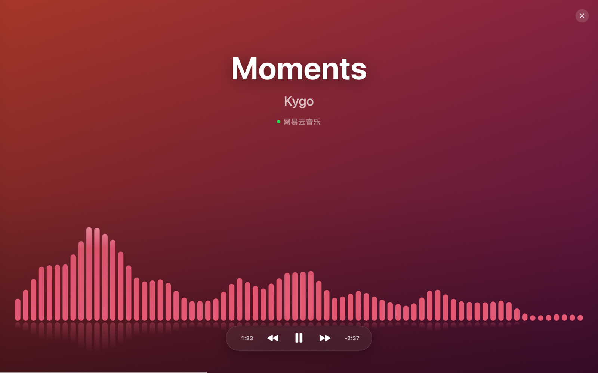
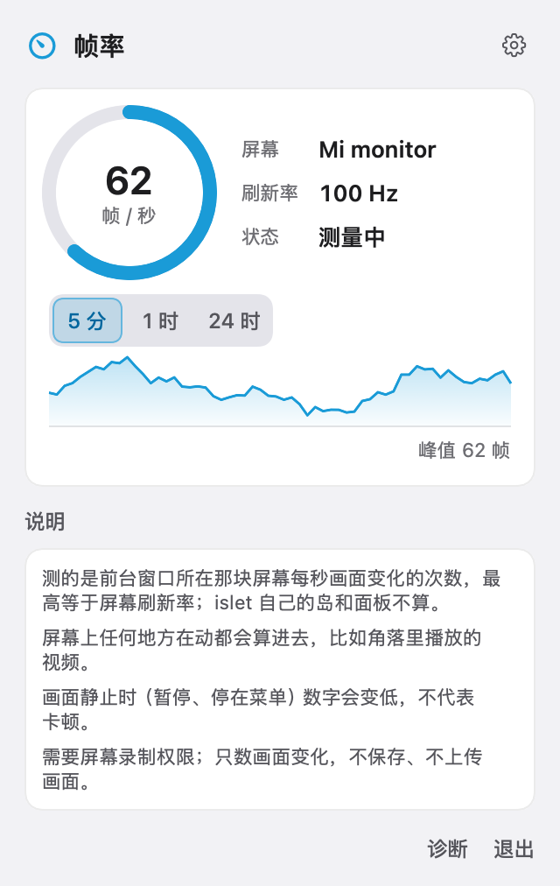
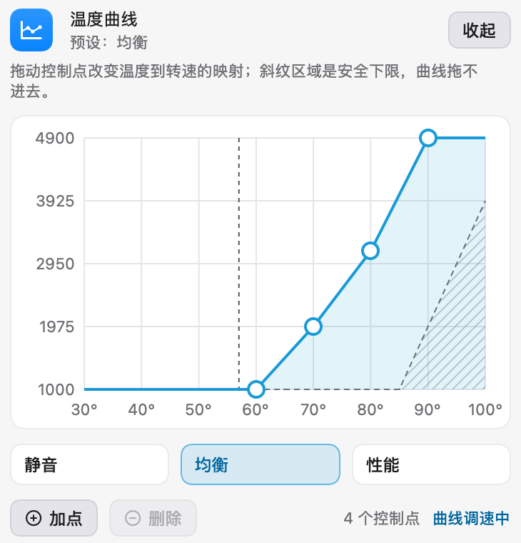

<p align="center">
  
</p>

<h1 align="center">islet</h1>

<p align="center">菜单栏里的灵动岛：系统指标、音乐频谱、蓝牙电量，一眼看全。</p>

<p align="center">官网：<a href="https://buerxzhang.github.io/islet/">buerxzhang.github.io/islet</a>（可以在网页里直接点着体验）</p>

<p align="center">
  <a href="https://github.com/Buerxzhang/islet/releases/latest"></a>
  <a href="https://buerxzhang.github.io/islet/"></a>
  
  
  <a href="https://github.com/Buerxzhang/islet/stargazers"></a>
</p>

<p align="center">
  
</p>

islet 是一个 macOS 菜单栏工具。它把 CPU、内存、网速这些常看的数字，和正在播放的音乐、蓝牙设备的电量，收进菜单栏里的一枚胶囊。平时它只是一排指标；电脑里有声音时，胶囊向左展开出封面和频谱；点开任意一项，是更详细的面板。

## 灵动岛

胶囊会随连接的设备和正在出声的程序变化。下面用示例数据展示不同状态。

### 启用了刘海屏时

islet 启动时，如果检测到任意一块启用的屏幕有刘海，默认显示 CPU、内存、温度和网速。内屏和外接屏共用同一套指标设置，可以在设置里增减指标。

<table>
  <tr>
    <td width="170" nowrap>没有可显示的蓝牙电量</td>
    <td></td>
  </tr>
  <tr>
    <td width="170" nowrap>仅显示音乐与频谱</td>
    <td></td>
  </tr>
  <tr>
    <td width="170" nowrap>指标＋蓝牙电量<br><sub>右侧圆环是蓝牙电量</sub></td>
    <td></td>
  </tr>
  <tr>
    <td width="170" nowrap>其他程序出声<br><sub>显示程序图标</sub></td>
    <td></td>
  </tr>
  <tr>
    <td width="170" nowrap>播放视频<br><sub>示例中只支持播放 / 暂停</sub></td>
    <td></td>
  </tr>
  <tr>
    <td width="170" nowrap>播放音乐<br><sub>读取到封面时使用封面色</sub></td>
    <td></td>
  </tr>
  <tr>
    <td width="170" nowrap>音乐暂停</td>
    <td></td>
  </tr>
</table>

### 只使用无刘海屏时

默认显示更多指标。无风扇的机型默认隐藏风扇项。

<table>
  <tr>
    <td width="170" nowrap>没有可显示的蓝牙电量</td>
    <td></td>
  </tr>
  <tr>
    <td width="170" nowrap>仅显示音乐与频谱</td>
    <td></td>
  </tr>
  <tr>
    <td width="170" nowrap>指标＋蓝牙电量<br><sub>右侧圆环是蓝牙电量</sub></td>
    <td></td>
  </tr>
  <tr>
    <td width="170" nowrap>其他程序出声<br><sub>显示程序图标</sub></td>
    <td></td>
  </tr>
  <tr>
    <td width="170" nowrap>播放视频<br><sub>示例中只支持播放 / 暂停</sub></td>
    <td></td>
  </tr>
  <tr>
    <td width="170" nowrap>播放音乐<br><sub>读取到封面时使用封面色</sub></td>
    <td></td>
  </tr>
  <tr>
    <td width="170" nowrap>音乐暂停</td>
    <td></td>
  </tr>
</table>

- 显示哪些指标、按什么顺序排，都在设置里拖动调整。网速可以只显示上传和下载中较快的一方。
- 不想看的项目，点开它的面板，按右上角划掉的眼睛图标就能从岛上隐藏；要找回来，到设置里拖回「显示在岛上」，或者点列表下方的「恢复默认显示和顺序」。
- 可以把所有项目都隐藏，这时胶囊只在播放音乐、蓝牙设备连上时出现；再次打开 islet 就会弹出设置。只留「音乐」、其他都隐藏，就是只显示音乐的模式：平时看不到胶囊，有声音时才展开。
- 蓝牙电量圆环的绿、橙、红分别表示充足、偏低、不足。
- 岛固定在菜单栏最左侧。有新图标挤进来或者被 ⌘ 拖走，它会自己回到原位（可以关掉，关掉后可以按住 ⌘ 拖到任意位置）。
- **全局悬浮**：把胶囊从菜单栏里拿出来，居中悬浮在刘海或菜单栏正下方。可以选择在全屏视频和游戏上也保持显示，或者打开「自由拖动」，按住胶囊放到屏幕任意位置。
- 胶囊底色可选专辑色、渐变或黑色；设置顶部有示例数据的实时预览。
- 胶囊外有一圈细亮边，在深色壁纸上也不会和菜单栏糊在一起。
- 胶囊上右键，可以快速打开设置、开关全局悬浮和平滑滚动。

## 音乐

实时频谱需要 macOS 14.2 或更新版本。

<p align="center">
  
</p>

- 支持网易云音乐、Apple Music、QQ 音乐、Spotify 等播放器。能读取封面时，频谱和按钮使用封面色，切歌时颜色渐变。
- 按钮跟着应用实际支持的操作走：微信语音、网页视频这类不能切歌的，只显示播放和暂停。
- 岛上显示的是此刻真正在出声的程序。视频暂停了、音乐还在放，显示的就是音乐；游戏和剪辑软件出声时显示它们的图标，Wine / CrossOver 运行的 Windows 游戏也认得出来。点面板里的程序图标可以切到它。不想看到音乐以外的程序，可以在设置里关掉「其他程序的声音」。
- 面板下方是声音输出：调音量、静音，点一下切换输出设备。
- 样式都可以在设置里调：频谱用竖条或点阵，圆形或圆角，颜色取专辑色、图标色或白色；封面可以像黑胶一样边播边转；可以隐藏岛上的播放按钮。
- 灵敏度分低、标准、高三档，安静的歌调高也能跳得明显；停止播放后可以立即收起、10 秒后收起或一直不收。

点播放卡片右上角的放大按钮，可以进入全屏频谱：封面做模糊背景，频谱铺满屏幕底部，多块屏幕时可以选择显示在哪一块。

<p align="center">
  
</p>

## 详细面板

<table>
  <tr>
    <td align="center" valign="top" width="33%"></td>
    <td align="center" valign="top" width="33%"></td>
    <td align="center" valign="top" width="33%"></td>
  </tr>
  <tr>
    <td align="center">CPU</td>
    <td align="center">网速</td>
    <td align="center">功耗</td>
  </tr>
</table>

面板提供 5 分钟、1 小时、24 小时三个走势视图。CPU、GPU、内存、磁盘读写、功耗、网速都有应用排行（显示 3、5 或 8 条可以设置），风扇面板按功耗列出发热来源。

- 排行里鼠标移到某个程序上会出现「结束」，再点一次退出它；3 秒后还没退出，可以强制结束。系统进程不显示这个按钮。
- CPU：性能核与能效核的核心数和占用。内存：内存压力和交换。
- 网速：每个应用的实时流量、今日和本月流量（每月从哪天算起可以设置，方便对齐运营商账单，也可以清零）、公网 IP、Wi-Fi 信号、延迟。
- 功耗：整机功耗、电池健康度和循环次数。「保持唤醒」可以让电脑 30 分钟、2 小时或一直不休眠（选「一直」时重启 islet 后也保持），还可以让屏幕也保持常亮，适合下载或渲染时用。
- 磁盘：启动盘用量、系统能读取的 NVMe 硬盘 SMART 状态；列出 U 盘、移动硬盘、网络共享等外接卷，可以直接推出。
- 温度：CPU、GPU、硬盘、内存等传感器的读数，按部件分组，可以展开看全部探测点。

## 帧率

<p align="center">
  
</p>

打开后，岛上会多一项「FPS」，显示屏幕每秒画面变化的次数。测的是前台窗口所在的那块屏幕，多块屏幕时跟着前台窗口走；islet 自己的岛和面板不算。默认关闭，在设置里打开时需要授予屏幕录制权限。

- 读数反映屏幕画面变化的频率，画面静止时会降低。游戏自身的渲染帧率需以游戏内计数器为准。
- 屏幕上任何地方在动都会算进去，比如角落里播放的视频。
- 只统计画面有没有变化：画面缩到 128 像素宽，算完就丢，不保存、不上传。
- 只在 FPS 显示或面板打开时测量，关掉就完全停止。

## 风扇调速

<p align="center">
  
</p>

适用于 islet 能识别并控制风扇的机型。可选三种调速方式：

- 固定：设定固定目标转速。
- 温度曲线：拖动控制点，设定不同温度对应的转速。内置静音、均衡、性能三套预设，可以在预设基础上微调。
- 规则：比如「CPU 温度高于 85°C 时提到 3300 转」。可以写多条，同时满足时取最高的转速；温度要回落一点才解除，避免风扇来回启停；都不满足时交还给系统。

不管用哪种方式，转速都不会低于按当前温度算出的安全下限，也不会让风扇停转。调速需要安装一个辅助组件（会请求一次管理员密码），随时可以切回「自动」或者卸载。

## 蓝牙

<p align="center">
  
</p>

面板里列出已配对的设备，点一下就能连接或断开。部分索尼耳机在系统未显示电量时，也可以通过 islet 读取。

蓝牙关闭时，面板里可以直接打开；但面板不提供关闭蓝牙的开关，免得误点后蓝牙键盘、鼠标一起断开。要关闭请到系统设置。

电量低于设定值时会发一条通知，标题写明是什么设备，右边附上电量圆环：

<p align="center">
  
</p>

提醒的电量（10% 到 30%）和提示音都能调，设置里也可以先发一条测试通知看看效果。

## 扩展功能

设置里的「扩展功能」页，放的是和灵动岛无关、但常用的小工具，都默认关闭：

- **鼠标平滑滚动**：让有刻度的鼠标滚轮像触控板一样顺滑。滚动距离、平滑程度各有三档，可以单独反转鼠标的滚动方向；触控板不受影响，检测到其他平滑滚动工具在运行时自动让开。需要辅助功能权限。
- **显示器**：每块屏一排分辨率卡片，原生在最左，往右文字越来越大，标出「推荐」「原生」、界面放大比例，以及当前是 HiDPI 还是普通模式、实际按多大尺寸绘制；默认列 5 档，其余在「更多分辨率」里。切换后 15 秒内不确认会自动恢复。
  - 2K、带鱼屏这类系统不支持 HiDPI 的外接屏，打开「HiDPI 支持」会添加 7 个与原生严格等比例的 HiDPI 档位，并切到按屏幕尺寸推荐的大小，文字会细腻很多。需要管理员密码，关掉只删 islet 自己写的配置。

## 其他

- 提醒规则：温度、CPU、GPU、功耗、内存持续偏高一段时间时发通知，回落后才会再次提醒。
- 支持 ℃ / ℉、MB/s / Mb/s 切换；主题可选浅色、深色或跟随系统。
- 登录时启动；菜单栏刷新频率可选 1、2、3 秒，越快越耗电。
- 「恢复默认设置」会重置 islet 的偏好并重启，流量统计、显示器配置和系统权限保留。
- 诊断：「关于」页可以复制一份诊断报告（机型、系统、传感器、风扇状态等），点「反馈问题」时会自动复制，到 GitHub 粘贴即可。
- 应用内更新：在「关于」页完成，不弹窗。每天最多自动检查一次 GitHub，有新版本时打开「关于」页显示更新说明；点「下载更新」后能看到进度，下载好再点「重启以完成更新」，什么时候重启由你决定，也可以跳过这个版本。下载后会核对校验和与签名，任何一步失败都不会动现有程序。

## 安装

支持 Apple 芯片和 Intel，需要 macOS 14 或更新版本。实时频谱需要 macOS 14.2 或更新版本。

1. 到 [最新版发布页](https://github.com/Buerxzhang/islet/releases/latest) 下载 `islet.zip`，解压后把 **islet.app** 拖进「应用程序」文件夹。
2. 第一次打开时，macOS 可能会提示「无法验证开发者」。在「应用程序」里**右键 islet → 打开**，或者到「系统设置 → 隐私与安全性」点「仍要打开」。
3. 按提示授予权限：

| 权限 | 用来做什么 |
|---|---|
| 系统录音 | 画频谱。只读取电脑播放出来的声音，不录麦克风，也不保存、不上传 |
| 蓝牙 | 显示、连接、断开已配对的设备，读取电量 |
| 通知 | 提醒规则和低电量提醒 |
| 辅助功能（可选） | 鼠标平滑滚动 |
| 屏幕录制（可选） | 帧率：只统计屏幕画面变化的次数，不保存、不上传画面 |
| 管理员密码（可选） | 安装风扇调速组件；为外接屏添加或移除 HiDPI 档位 |

> 1.3.1 及以后的版本可以直接在「关于」页更新。更早的版本手动升级：先退出旧应用并把它移出「应用程序」，再放入新版。设置和历史会沿用，macOS 可能要求重新授权。
>
> 风扇调速要求 islet 放在「应用程序」文件夹里。旧版用户需在设置里重新安装风扇组件，安装时会移除旧组件。

## 从源码构建

需要 Xcode 命令行工具（`xcode-select --install`）。

```bash
./build.sh            # 构建到 build/islet.app
./build.sh install    # 构建并安装到 /Applications，然后启动
```

## 隐私

islet 不收集、不上传任何使用数据。只有这几种情况会联网：查询公网 IP（ipify）、测量延迟（连接公共 DNS）、打开「关于」页时查询 GitHub 标星数、检查更新时查询 GitHub 上的最新版本、更新时从 GitHub 下载安装包（可以在「关于」页关掉自动检查）。打开帧率时用到的屏幕录制只在本机统计画面变化，画面不保存、不上传。

## 已知限制

- 正在播放、SMC 风扇、蓝牙电量等功能用到了 macOS 未公开的接口，系统更新后可能失效。
- 风扇调速是直接操作硬件。转速有安全下限、不会停转，但仍请自行承担风险；遇到异常就切回「自动」或卸载组件。
- 索尼耳机的电量要通过耳机的控制通道读取，手机上开着索尼 App 时可能读不到。
- 副屏菜单栏里的频谱是系统复制过去显示的，可能不够流畅。

## 支持作者

如果 islet 对你有用，欢迎点个 ⭐️，也可以请作者喝杯咖啡 ☕️

<table align="center">
  <tr>
    <td align="center"></td>
    <td align="center"></td>
  </tr>
  <tr>
    <td align="center">支付宝</td>
    <td align="center">微信</td>
  </tr>
</table>

## 许可证

[MIT](LICENSE) © Buerxzhang
