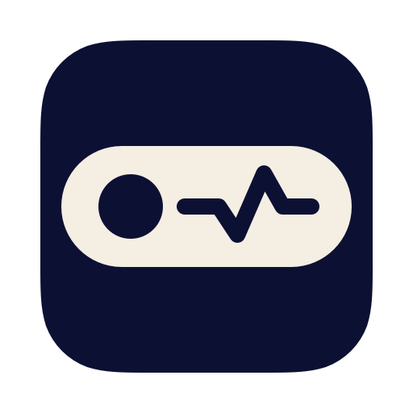
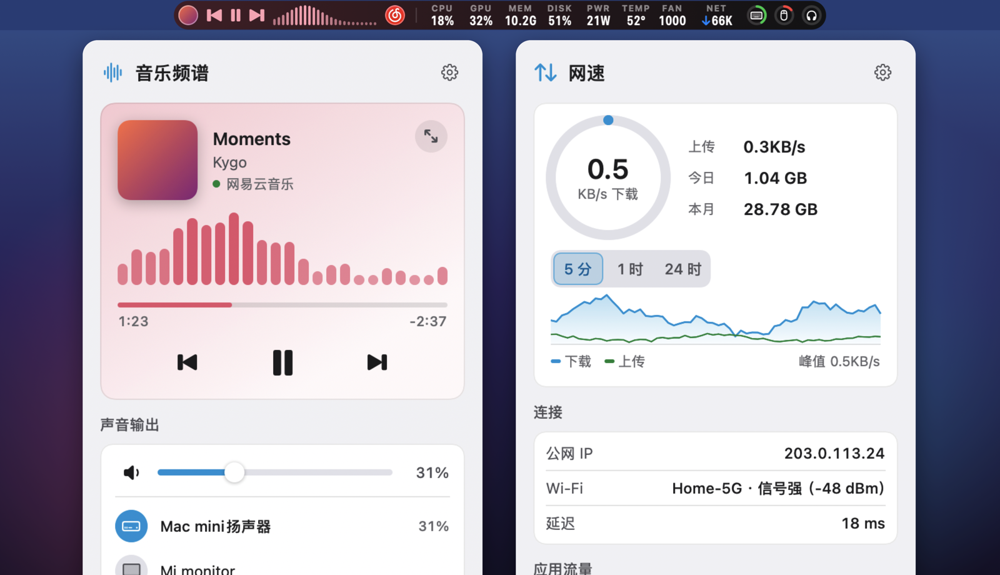
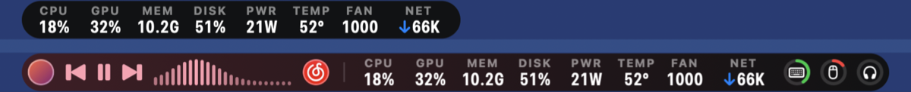
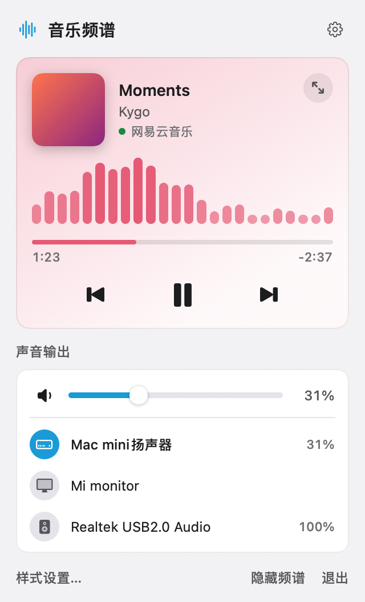
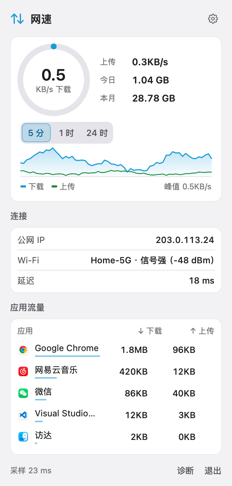
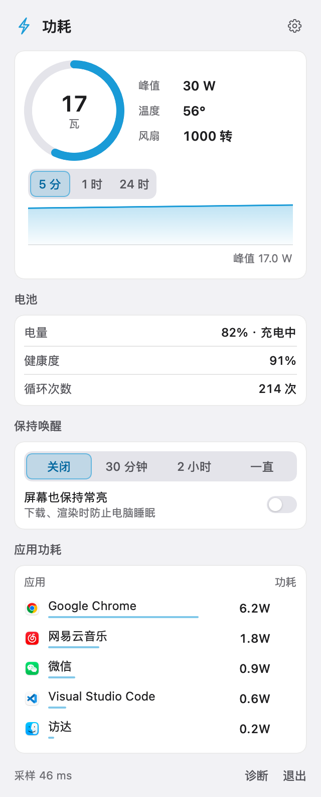

<p align="center">
  
</p>

<h1 align="center">Islet</h1>

<p align="center">菜单栏里的灵动岛：系统指标、音乐频谱、蓝牙电量，一眼看全。</p>

<p align="center">
  
  
  <a href="https://github.com/Buerxzhang/Islet/releases"></a>
  <a href="https://github.com/Buerxzhang/Islet/stargazers"></a>
</p>

<p align="center">
  
</p>

---

## 为什么用 Islet

- **一枚胶囊，装下所有状态**：CPU、GPU、内存、功耗、温度、网速、蓝牙电量，不再是菜单栏里散落的一排小图标。
- **音乐来了，岛就展开**：有声音时自动向左展开出封面、播放按钮和实时频谱，颜色跟着封面变；停了再收起。
- **谁在发声，一眼看清**：以系统实际的声音输出为准，视频、语音、游戏的声音也能认出来。
- **点开就是详情**：每一项点开都有排行和走势，查问题不用再开「活动监视器」。

## 灵动岛

<p align="center">
  
</p>

- 上：平时只显示指标。下：播放音乐时向左展开，右侧是蓝牙设备的电量圈（绿 / 橙 / 红）。
- 指标可拖动排序、单独开关；网速可选只显示较快的一方，CPU / GPU 可用迷你曲线代替数字。
- 始终排在菜单栏最左侧，新图标出现或被 ⌘ 拖走后自动归位（可关闭）。
- 深色壁纸上有一圈细亮边，岛不会和菜单栏融在一起。

## 音乐

<p align="center">
  
</p>

- 识别网易云、Apple Music、QQ 音乐、Spotify 等正在播放的应用，封面取色，切歌时颜色平滑过渡。
- 按应用实际支持的操作显示按钮：微信语音、网页视频等只显示播放 / 暂停。
- 游戏、剪辑软件发出声音时显示该程序的图标（包括 Wine / CrossOver 转译的 Windows 游戏）。
- 全屏频谱：模糊封面背景 + 大号频谱，可选显示在哪块屏幕。

## 详细面板

<table>
  <tr>
    <td align="center"><br>CPU：占用排行、核心、温度、功耗</td>
    <td align="center"><br>网速：今日 / 本月流量、连接信息、应用流量</td>
    <td align="center"><br>功耗：耗电排行、电池健康、保持唤醒</td>
  </tr>
</table>

- 每个指标都有 5 分钟 / 1 小时 / 24 小时走势。
- **磁盘**：读写排行、外接磁盘、硬盘 SMART 健康状态。
- **风扇**：按温度曲线或规则调速（需安装控制组件）。

## 蓝牙

<p align="center">
  
</p>

- 已连接设备以圆环显示电量，点设备即可连接 / 断开；支持索尼耳机等系统读不到电量的设备。
- 低电量通知会写明是什么设备（如「键盘 BKB02_1 电量低」）并附电量环；提醒电量、提示音可设置，还能发测试通知。

## 其他

- 提醒规则：温度、CPU、GPU、功耗、内存持续过高时发系统通知。
- 动态壁纸：让 macOS 动态壁纸在桌面持续播放。
- 单位切换（℃ / ℉、MB/s / Mb/s）、深浅色主题、设置导出 / 导入。

## 安装

1. 在 [Releases](https://github.com/Buerxzhang/Islet/releases) 下载最新的 `Islet.zip`，解压后把 **Islet.app** 拖到「应用程序」文件夹。
2. 首次打开时 macOS 可能提示「无法验证开发者」：在「应用程序」里**右键 Islet → 打开**，或到「系统设置 → 隐私与安全性」点「仍要打开」。
3. 按提示授予权限：

| 权限 | 用途 |
|---|---|
| 系统录音 | 频谱：只读取电脑播放出来的声音，不录麦克风，不保存、不上传 |
| 蓝牙 | 显示、连接 / 断开已配对设备，读取电量 |
| 通知 | 提醒规则、低电量提醒 |
| 管理员密码（可选） | 安装风扇控制组件 |

> 风扇控制要求 Islet 位于「应用程序」文件夹。

## 从源码构建

需要 Xcode 命令行工具（`xcode-select --install`）。

```bash
./build.sh            # 构建到 build/Islet.app
./build.sh install    # 构建并安装到 /Applications，然后启动
```

## 隐私

- 不收集、不上传任何使用数据。
- 只有以下情况会联网：查询公网 IP（ipify）、测量延迟（连接公共 DNS）、查询 GitHub 标星数（打开「关于」页时）。

## 已知限制

- 正在播放、SMC 风扇、蓝牙电量等功能使用了 macOS 未公开的接口，系统更新后可能失效。
- 风扇调速属于对硬件的直接操作：转速有按温度计算的安全下限、绝不停转，但仍请自行承担风险；出现异常时切回「自动」或卸载组件。
- 索尼耳机电量依赖耳机的控制通道，手机上开着索尼 App 时可能读不到。
- 副屏菜单栏里的频谱由系统复制显示，可能不够流畅。

## 支持作者

如果 Islet 对你有帮助，欢迎到 GitHub 点个 ⭐️，或者请作者喝杯咖啡 ☕️

<p align="center">
  
  &nbsp;&nbsp;
  
</p>

## 许可证

[MIT](LICENSE) © Buerxzhang
