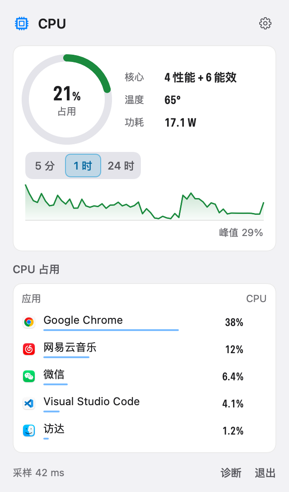
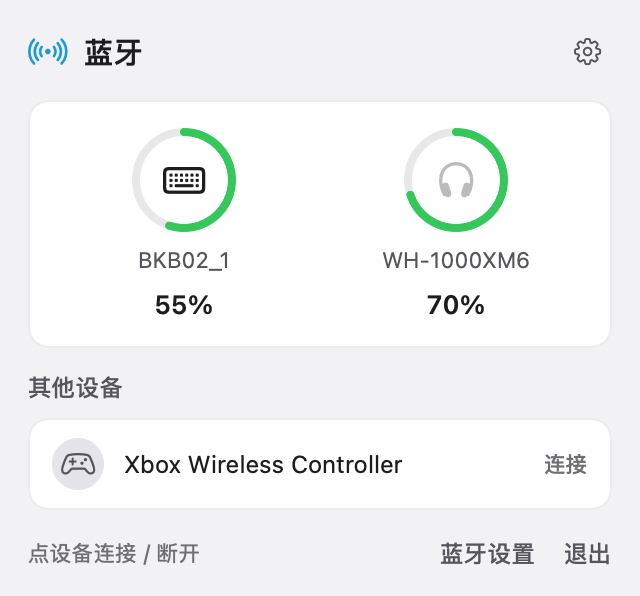

<p align="center">
  
</p>

<h1 align="center">Islet</h1>

<p align="center">菜单栏里的灵动岛：系统指标、音乐频谱、蓝牙电量，一眼看全。</p>

<p align="center">
  
  
  <a href="https://github.com/Buerxzhang/Islet/releases"></a>
  <a href="https://github.com/Buerxzhang/Islet/stargazers"></a>
</p>

<p align="center">
  
</p>

Islet 是一个 macOS 菜单栏工具。它把 CPU、内存、网速这些常看的数字，和正在播放的音乐、蓝牙设备的电量，收进菜单栏里的一枚胶囊。平时它只是一排指标；电脑里有声音时，胶囊向左展开出封面和频谱；点开任意一项，是更详细的面板。

## 灵动岛

同一枚胶囊，会随着连接的设备、正在出声的程序而变化：

<table>
  <tr>
    <td width="170" nowrap>平时<br><sub>右侧圆环是蓝牙电量</sub></td>
    <td></td>
  </tr>
  <tr>
    <td width="170" nowrap>没有连接蓝牙设备</td>
    <td></td>
  </tr>
  <tr>
    <td width="170" nowrap>刘海屏 MacBook<br><sub>默认只留常用指标</sub></td>
    <td></td>
  </tr>
  <tr>
    <td width="170" nowrap>播放音乐<br><sub>颜色取自封面</sub></td>
    <td></td>
  </tr>
  <tr>
    <td width="170" nowrap>音乐暂停</td>
    <td></td>
  </tr>
  <tr>
    <td width="170" nowrap>播放视频<br><sub>只有播放 / 暂停</sub></td>
    <td></td>
  </tr>
  <tr>
    <td width="170" nowrap>其他程序出声<br><sub>显示程序图标</sub></td>
    <td></td>
  </tr>
  <tr>
    <td width="170" nowrap>关掉全部指标<br><sub>有声音时才出现</sub></td>
    <td></td>
  </tr>
</table>

- 显示哪些指标、按什么顺序排，都在设置里拖动调整。网速可以只显示上传和下载中较快的一方，CPU、GPU 也可以换成迷你曲线。
- 蓝牙电量圆环的绿、橙、红分别表示充足、偏低、不足。
- 刘海屏机型的菜单栏放不下太多东西，Islet 第一次运行时只打开常用的几项，其余的可以在设置里再打开；没有风扇的机型（比如 MacBook Air）默认不显示风扇。
- 岛固定在菜单栏最左侧。有新图标挤进来或者被 ⌘ 拖走，它会自己回到原位（可以关掉）。
- 胶囊外有一圈细亮边，在深色壁纸上也不会和菜单栏糊在一起。

## 音乐

<p align="center">
  
</p>

- 支持网易云音乐、Apple Music、QQ 音乐、Spotify 等播放器。频谱和按钮的颜色取自封面，切歌时颜色渐变过去，不会突然跳变。
- 按钮跟着应用实际支持的操作走：微信语音、网页视频这类不能切歌的，只显示播放和暂停。
- 岛上显示的是此刻真正在出声的程序。视频暂停了、音乐还在放，显示的就是音乐；游戏和剪辑软件出声时显示它们的图标，Wine / CrossOver 运行的 Windows 游戏也认得出来。

点播放卡片右上角的放大按钮，可以进入全屏频谱：封面做模糊背景，频谱铺满屏幕底部，多块屏幕时可以选择显示在哪一块。

<p align="center">
  
</p>

## 详细面板

<table>
  <tr>
    <td align="center" valign="top" width="33%"></td>
    <td align="center" valign="top" width="33%"></td>
    <td align="center" valign="top" width="33%"></td>
  </tr>
  <tr>
    <td align="center">CPU</td>
    <td align="center">网速</td>
    <td align="center">功耗</td>
  </tr>
</table>

每一项点开都有占用排行，以及最近 5 分钟、1 小时、24 小时的走势。各面板还有一些自己的内容：

- 网速：今日和本月流量（每月从哪天算起可以设置）、公网 IP、Wi-Fi 信号、延迟。
- 功耗：电池健康度和循环次数，还能临时不让电脑休眠，适合下载或渲染时用。
- 磁盘：外接磁盘，以及每块硬盘的 SMART 健康状态。
- 温度：CPU、GPU、硬盘、内存等传感器的读数，按部件分组。

## 风扇调速

<p align="center">
  
</p>

macOS 自带的风扇策略比较保守，往往等温度上去了，风扇才慢慢跟上。Islet 提供三种调速方式：

- 固定：一直保持某个转速。
- 温度曲线：拖动控制点，设定不同温度对应的转速。内置静音、均衡、性能三套预设，可以在预设基础上微调。
- 规则：比如「CPU 温度高于 85°C 时提到 3300 转」。可以写多条，同时满足时取最高的转速；温度要回落一点才解除，避免风扇来回启停；都不满足时交还给系统。

不管用哪种方式，转速都不会低于按当前温度算出的安全下限，也不会让风扇停转。调速需要安装一个辅助组件（会请求一次管理员密码），随时可以切回「自动」或者卸载。

## 蓝牙

<p align="center">
  
</p>

面板里列出已配对的设备，点一下就能连接或断开。索尼耳机这类系统读不到电量的设备，Islet 也能读出来。

电量低于设定值时会发一条通知，标题写明是什么设备，右边附上电量圆环：

<p align="center">
  
</p>

提醒的电量（10% 到 30%）和提示音都能调，设置里也可以先发一条测试通知看看效果。

## 其他

- 提醒规则：温度、CPU、GPU、功耗、内存持续偏高时发通知。
- 动态壁纸：让 macOS 的动态壁纸在桌面上一直播放。
- 支持 ℃ / ℉、MB/s / Mb/s 切换，深浅色主题，设置可以导出、导入。

## 安装

1. 到 [Releases](https://github.com/Buerxzhang/Islet/releases) 下载最新的 `Islet.zip`，解压后把 **Islet.app** 拖进「应用程序」文件夹。
2. 第一次打开时，macOS 可能会提示「无法验证开发者」。在「应用程序」里**右键 Islet → 打开**，或者到「系统设置 → 隐私与安全性」点「仍要打开」。
3. 按提示授予权限：

| 权限 | 用来做什么 |
|---|---|
| 系统录音 | 画频谱。只读取电脑播放出来的声音，不录麦克风，也不保存、不上传 |
| 蓝牙 | 显示、连接、断开已配对的设备，读取电量 |
| 通知 | 提醒规则和低电量提醒 |
| 管理员密码（可选） | 安装风扇调速组件 |

> 风扇调速要求 Islet 放在「应用程序」文件夹里。

## 从源码构建

需要 Xcode 命令行工具（`xcode-select --install`）。

```bash
./build.sh            # 构建到 build/Islet.app
./build.sh install    # 构建并安装到 /Applications，然后启动
```

## 隐私

Islet 不收集、不上传任何使用数据。只有三种情况会联网：查询公网 IP（ipify）、测量延迟（连接公共 DNS）、打开「关于」页时查询 GitHub 标星数。

## 已知限制

- 正在播放、SMC 风扇、蓝牙电量等功能用到了 macOS 未公开的接口，系统更新后可能失效。
- 风扇调速是直接操作硬件。转速有安全下限、不会停转，但仍请自行承担风险；遇到异常就切回「自动」或卸载组件。
- 索尼耳机的电量要通过耳机的控制通道读取，手机上开着索尼 App 时可能读不到。
- 副屏菜单栏里的频谱是系统复制过去显示的，可能不够流畅。

## 支持作者

如果 Islet 对你有用，欢迎点个 ⭐️，也可以请作者喝杯咖啡 ☕️

<p align="center">
  
  &nbsp;&nbsp;
  
</p>

## 许可证

[MIT](LICENSE) © Buerxzhang
