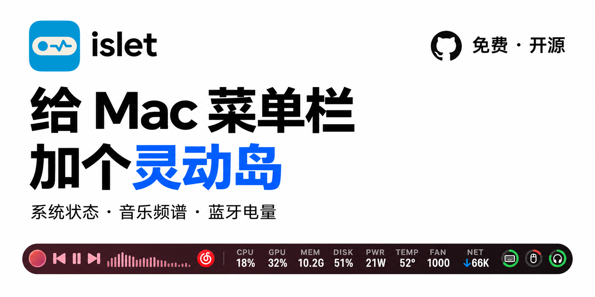
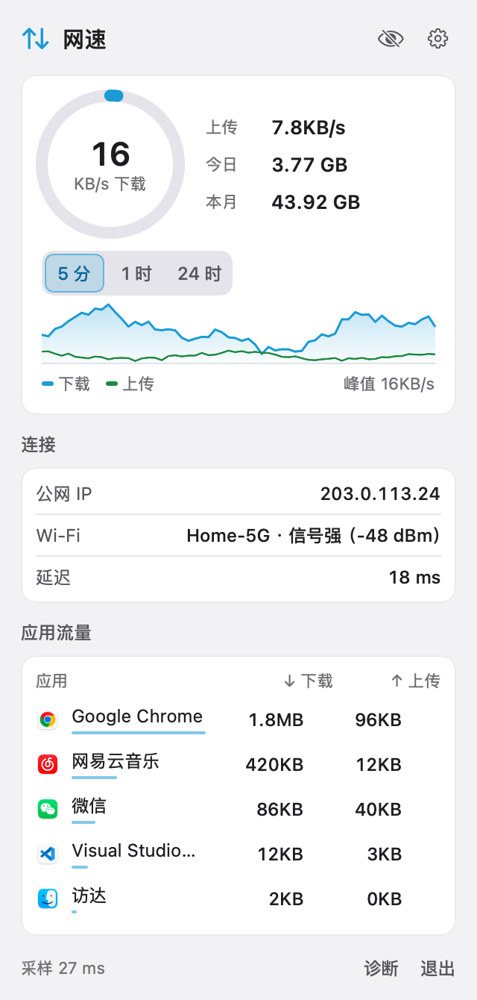
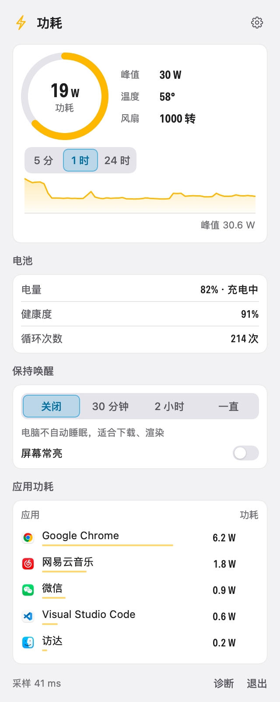
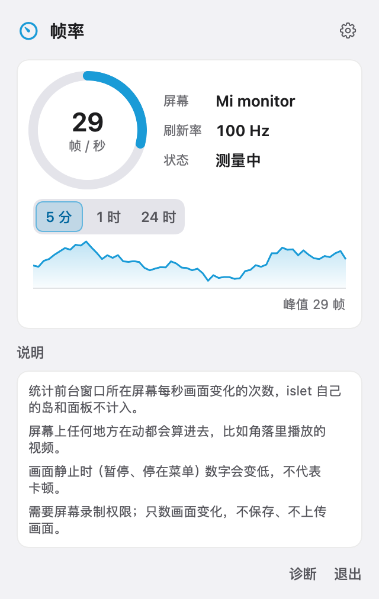
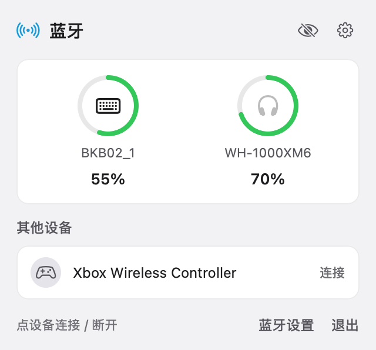
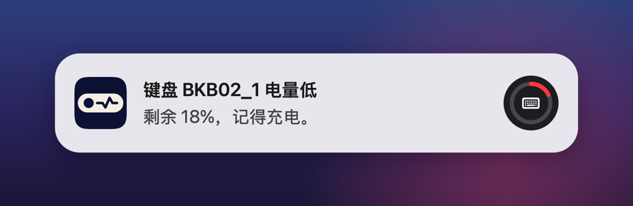
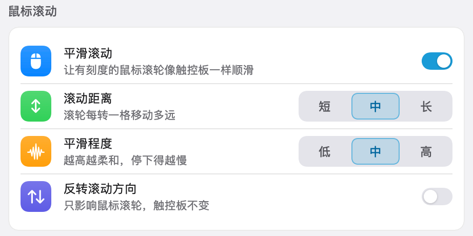
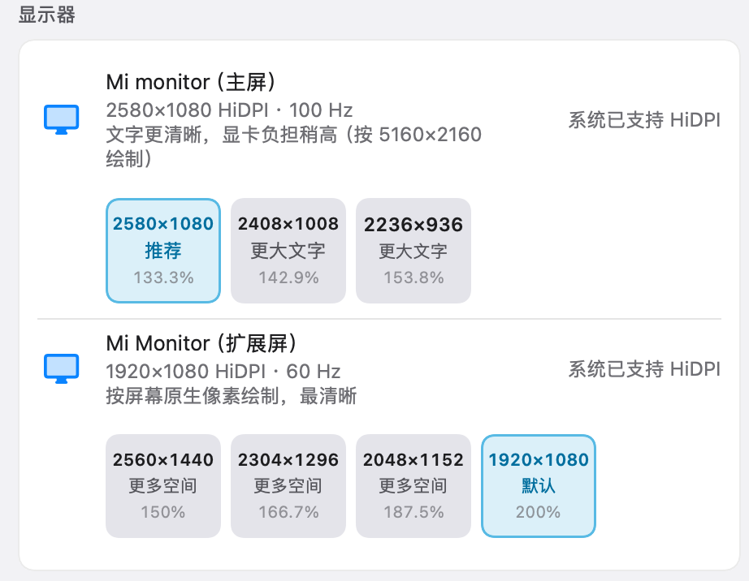

<p align="center">
  
</p>

<h1 align="center">islet</h1>

<p align="center">官网：<a href="https://buerxzhang.github.io/islet/">buerxzhang.github.io/islet</a></p>

<p align="center">
  <a href="https://github.com/Buerxzhang/islet/releases/latest"></a>
  <a href="https://buerxzhang.github.io/islet/"></a>
  
  
  <a href="https://github.com/Buerxzhang/islet/stargazers"></a>
</p>

islet 把 CPU、内存、网速这些常看的数字，和正在播放的音乐、蓝牙设备电量，收进菜单栏里的一枚胶囊。有声音时胶囊展开出封面和频谱，点开任意一项是详细面板。

## 灵动岛

下面的状态图用的是示例数据，画的是新装默认的分体胶囊。

### 刘海屏

默认悬浮在刘海正下方（避免右侧菜单栏图标被刘海挡住），显示 CPU、内存、温度和网速。

<table>
  <tr>
    <td width="170" nowrap>没有可显示的蓝牙电量</td>
    <td></td>
  </tr>
  <tr>
    <td width="170" nowrap>仅显示音乐与频谱</td>
    <td></td>
  </tr>
  <tr>
    <td width="170" nowrap>指标＋蓝牙电量<br><sub>右侧圆环是蓝牙电量</sub></td>
    <td></td>
  </tr>
  <tr>
    <td width="170" nowrap>其他程序出声<br><sub>显示程序图标</sub></td>
    <td></td>
  </tr>
  <tr>
    <td width="170" nowrap>播放视频<br><sub>示例中只支持播放 / 暂停</sub></td>
    <td></td>
  </tr>
  <tr>
    <td width="170" nowrap>播放音乐<br><sub>读取到封面时使用封面色</sub></td>
    <td></td>
  </tr>
  <tr>
    <td width="170" nowrap>音乐暂停</td>
    <td></td>
  </tr>
</table>

### 无刘海屏

默认在菜单栏里，显示更多指标；无风扇的机型不显示风扇。

<table>
  <tr>
    <td width="170" nowrap>没有可显示的蓝牙电量</td>
    <td></td>
  </tr>
  <tr>
    <td width="170" nowrap>仅显示音乐与频谱</td>
    <td></td>
  </tr>
  <tr>
    <td width="170" nowrap>指标＋蓝牙电量<br><sub>右侧圆环是蓝牙电量</sub></td>
    <td></td>
  </tr>
  <tr>
    <td width="170" nowrap>其他程序出声<br><sub>显示程序图标</sub></td>
    <td></td>
  </tr>
  <tr>
    <td width="170" nowrap>播放视频<br><sub>示例中只支持播放 / 暂停</sub></td>
    <td></td>
  </tr>
  <tr>
    <td width="170" nowrap>播放音乐<br><sub>读取到封面时使用封面色</sub></td>
    <td></td>
  </tr>
  <tr>
    <td width="170" nowrap>音乐暂停</td>
    <td></td>
  </tr>
</table>

- **显示内容**：在设置里用开关显示或隐藏，按住拖动调整顺序；右键胶囊也能直接隐藏点到的那一项。
- **胶囊形态**：分体时音乐、系统指标、蓝牙电量各成一个小胶囊；合并时连成一枚，所有项可以任意排序。
- **样式**：渐变（播放时跟随专辑色，平时是 islet 的主题蓝）、黑色、玻璃。玻璃是系统的 Liquid Glass，仅在悬浮模式生效。
- **位置**：可以固定在菜单栏最左侧，也可以悬浮在刘海或菜单栏下方；悬浮时可以自由拖动、选择显示在哪块屏幕、全屏时保持显示。
- **颜色**：CPU、GPU、内存、磁盘、温度偏高时变橙，很高时变红；蓝牙电量圆环按电量变绿、橙、红。
- 只留「音乐」时，打开音乐软件或有声音时胶囊才出现。

## 音乐

实时频谱需要 macOS 14.2 或更新版本。

<p align="center">
  
</p>

- 打开音乐软件就显示它的图标；播放时显示封面，颜色跟随封面，没有封面时用软件图标的颜色。
- 暂停后一直显示，随时能点继续；退出音乐软件才收起。
- 暂停、切歌按钮只在音乐软件出现。视频、网页、游戏出声时只显示它们的图标和频谱，声音停止后按设置收起。
- 面板下方可以调音量、切换输出设备；频谱样式、灵敏度都能在设置里调。

### 支持的音乐软件

软件自己声明为「音乐」类别的会自动识别；没有声明的，按下面的名单识别：

网易云音乐、QQ 音乐、Apple Music、Spotify、酷狗音乐、酷我音乐、播客、VOX、TIDAL、Amazon Music

> 目前只专门适配过**网易云音乐**和 **QQ 音乐**。其他播放器如果封面、按钮或播放状态不对，欢迎[提交 issue](https://github.com/Buerxzhang/islet/issues/new)，写明软件名称和现象。

点播放卡片右上角的放大按钮，进入全屏频谱：

<p align="center">
  
</p>

## 详细面板

<table>
  <tr>
    <td align="center" valign="top" width="33%"></td>
    <td align="center" valign="top" width="33%"></td>
    <td align="center" valign="top" width="33%"></td>
  </tr>
  <tr>
    <td align="center">CPU</td>
    <td align="center">网速</td>
    <td align="center">功耗</td>
  </tr>
</table>

- 5 分钟、1 小时、24 小时三个走势视图；圆环和走势线的颜色和岛上一致。
- CPU、GPU、内存、磁盘、功耗、网速都有应用排行，鼠标移上去可以直接结束程序。
- 网速：应用流量、今日和本月流量（起始日可设）、公网 IP、Wi-Fi 信号、延迟。
- 功耗：整机功耗、电池健康度；「保持唤醒」让电脑 30 分钟、2 小时或一直不休眠。
- 磁盘：启动盘用量、所有硬盘的读写速度、SMART 状态，外接卷可以直接推出。
- 温度：各部件传感器读数，按部件分组。

## 帧率

<p align="center">
  
</p>

显示前台窗口所在屏幕每秒画面变化的次数，画面静止时会变低。默认关闭，打开需要屏幕录制权限；只统计画面有没有变化，不保存、不上传。

## 风扇调速

<p align="center">
  
</p>

- **固定**：设定一个转速。
- **温度曲线**：拖动控制点设定温度对应的转速，内置静音、均衡、性能三套预设。
- **规则**：比如「CPU 高于 85°C 时提到 3300 转」，可以写多条。

转速有安全下限，不会停转。需要安装一个辅助组件（输入一次管理员密码），随时可以切回「自动」或卸载。

## 蓝牙电量

<p align="center">
  
</p>

- 点一下设备就能连接或断开；AirPods 分别显示左耳、右耳和充电盒电量。
- 第三方键盘、鼠标和部分索尼耳机的电量也能读到。
- 电量低于设定值时发通知，岛上不显示蓝牙时也有效：

<p align="center">
  
</p>

## 扩展功能

### 鼠标平滑滚动

让有刻度的鼠标滚轮像触控板一样顺滑，触控板不受影响。需要辅助功能权限。

<p align="center">
  
</p>

### 显示器与 HiDPI

- 每块屏只列切过去不会黑屏、闪屏的几档分辨率，点一下直接切换。
- 插拔屏幕后，自动切回每块屏最近用的那一档。
- 2K、带鱼屏这类系统不支持 HiDPI 的外接屏，可以一键添加 HiDPI 档位，文字更清晰。

<p align="center">
  
</p>

## 默认设置

新装时的样子（从旧版本升级的保留原来的设置）：

| 项 | 默认 |
|---|---|
| 位置 | 有刘海的屏悬浮在刘海下方，否则在菜单栏最左侧 |
| 胶囊 | 分体、渐变样式 |
| 显示的指标 | 有刘海：CPU、内存、温度、网速；无刘海：再加 GPU、磁盘、功耗、风扇（无风扇的机型不显示风扇）；帧率默认关闭 |
| 音乐、蓝牙电量 | 显示 |
| 声音停止后收起 | 10 秒（只对视频、网页、游戏等生效） |
| 低电量提醒 | 开，20% |
| 提醒规则 | 温度 ≥ 95° 持续 1 分钟 |
| 刷新频率 | 1 秒 |
| 平滑滚动、HiDPI、风扇调速、登录时启动 | 关 |

## 其他

- 提醒规则：温度、CPU、GPU、功耗、内存持续偏高时发通知。
- 支持 ℃ / ℉、MB/s / Mb/s。
- 「关于」页可以复制诊断报告、反馈问题，也在这里更新：下载后由你决定何时重启，设置保留。

## 安装

支持 Apple 芯片和 Intel，需要 macOS 14 或更新版本。

1. 到 [最新版发布页](https://github.com/Buerxzhang/islet/releases/latest) 下载 `islet.zip`，解压后把 **islet.app** 拖进「应用程序」。
2. 第一次打开如果提示「无法验证开发者」，在「应用程序」里**右键 islet → 打开**。
3. 按提示授予权限：

| 权限 | 用来做什么 |
|---|---|
| 系统录音 | 画频谱。只读取电脑播放出来的声音，不录麦克风，也不保存、不上传 |
| 蓝牙 | 显示、连接、断开已配对的设备，读取电量 |
| 通知 | 提醒规则和低电量提醒 |
| 辅助功能（可选） | 鼠标平滑滚动 |
| 屏幕录制（可选） | 帧率：只统计屏幕画面变化的次数，不保存、不上传画面 |
| 管理员密码（可选） | 安装风扇调速组件；为外接屏添加或移除 HiDPI 档位 |

> 1.3.1 及以后的版本可以在「关于」页直接更新。风扇调速要求 islet 放在「应用程序」里。

## 从源码构建

需要 Xcode 命令行工具（`xcode-select --install`）。

```bash
./build.sh            # 构建到 build/islet.app
./build.sh install    # 构建并安装到 /Applications，然后启动
```

目录结构：

```
Sources/          主程序源码（新增 .swift 放进去即可，build.sh 会整个目录编译）
  App/            入口、设置窗口、配色、更新、离屏渲染
  Island/         灵动岛胶囊和菜单栏图标
  Metrics/        系统指标采集和面板、提醒、保持唤醒
  Fan/            风扇控制
  Audio/          正在播放、频谱、声音和蓝牙
  Extensions/     平滑滚动、显示器 / HiDPI
Helpers/          独立的辅助程序：风扇组件、显示器配置工具、正在播放读取组件
Resources/        Info.plist、图标
docs/             官网（GitHub Pages）
```

## 隐私

islet 不收集、不上传任何使用数据。只在查询公网 IP、测量延迟、检查和下载更新、查询 GitHub 标星数时联网。

## 已知限制

- 正在播放、SMC 风扇、蓝牙电量等功能用到了 macOS 未公开的接口，系统更新后可能失效。
- 风扇调速直接操作硬件，请自行承担风险；异常时切回「自动」或卸载组件。
- 索尼耳机的电量要通过耳机的控制通道读取，手机上开着索尼 App 时可能读不到。
- 副屏菜单栏里的频谱是系统复制过去显示的，可能不够流畅。

## 支持作者

如果 islet 对你有用，欢迎点个 ⭐️，也可以请作者喝杯咖啡 ☕️

<table align="center">
  <tr>
    <td align="center"></td>
    <td align="center"></td>
  </tr>
  <tr>
    <td align="center">支付宝</td>
    <td align="center">微信</td>
  </tr>
</table>

## 许可证

[MIT](LICENSE) © Buerxzhang
